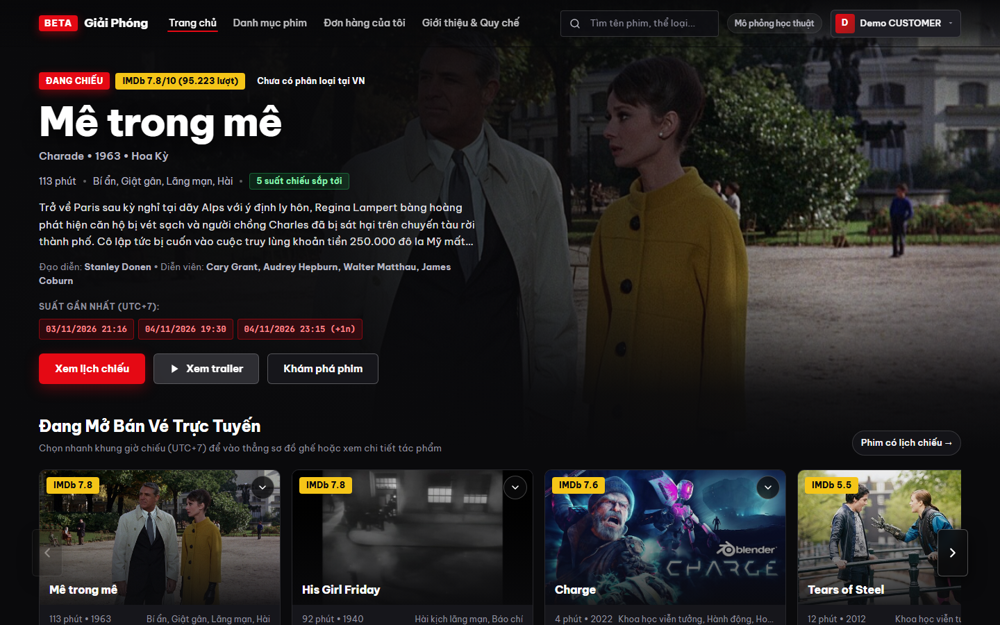
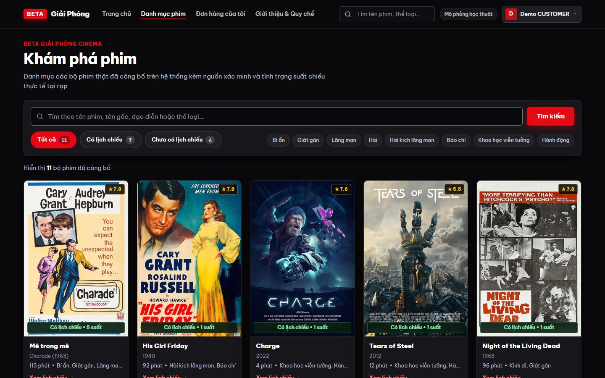
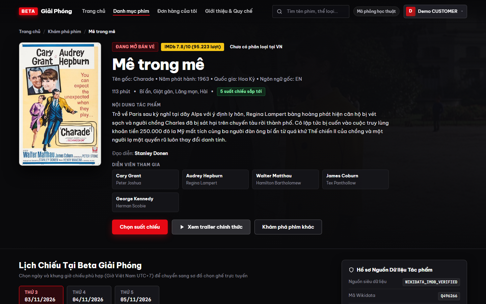
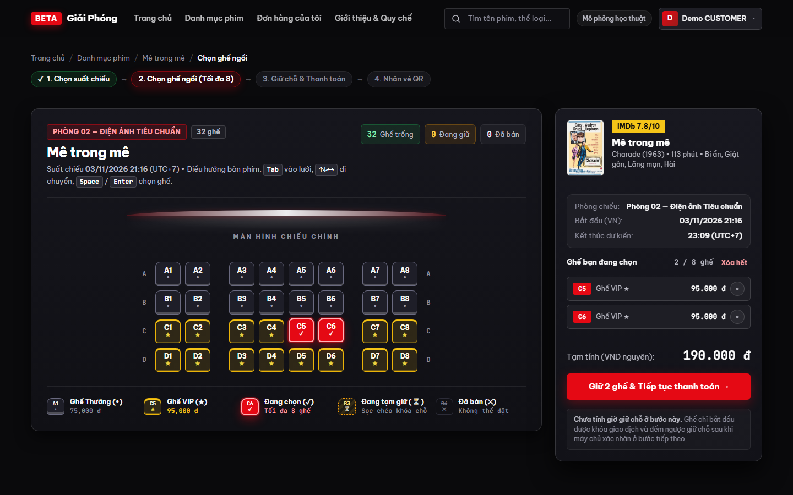
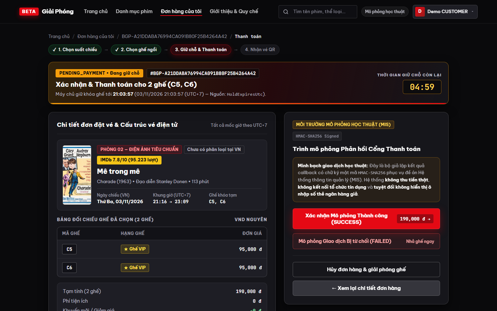
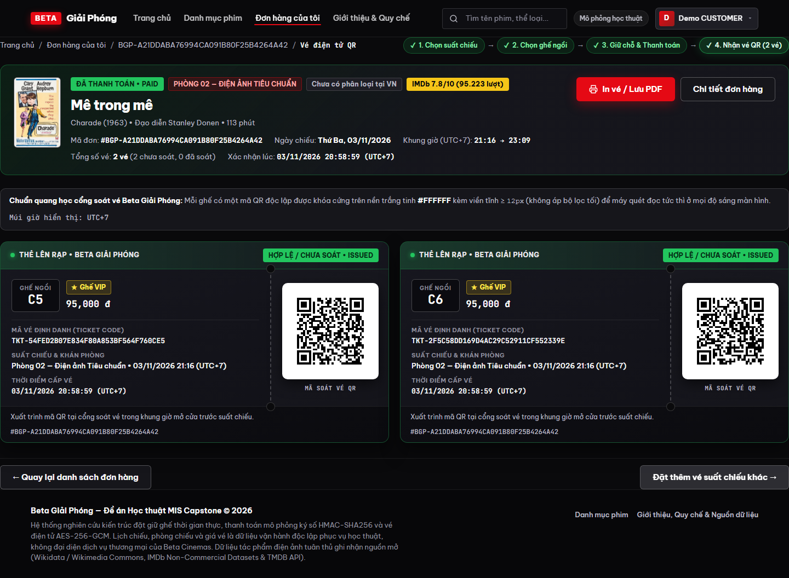
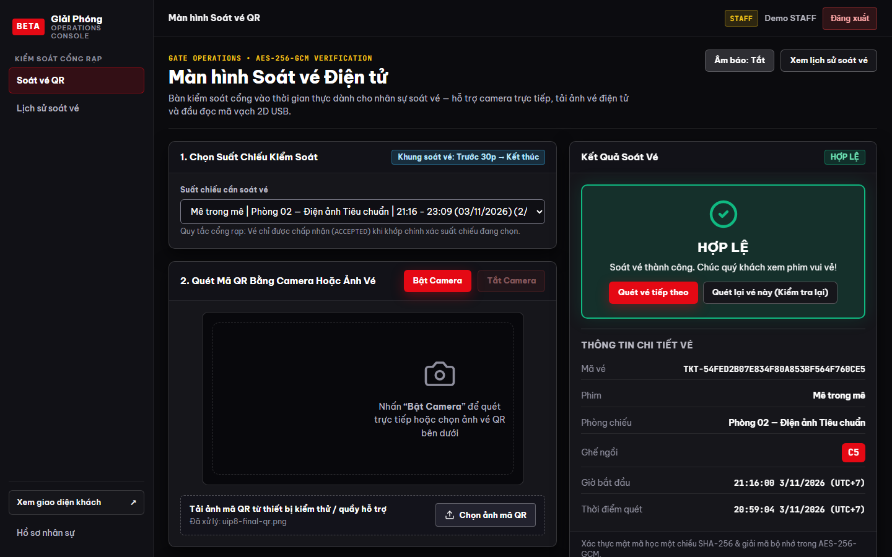
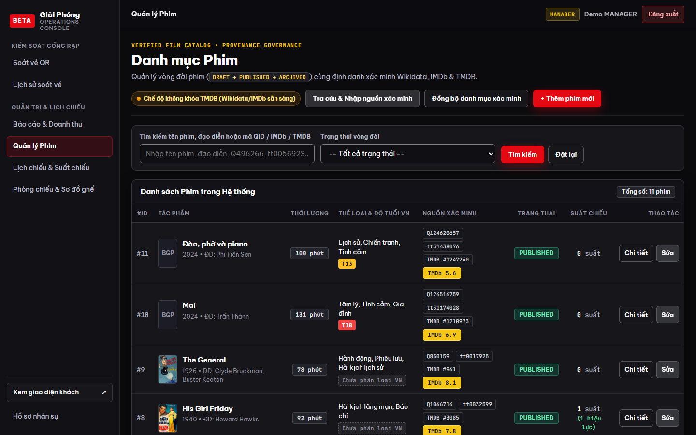
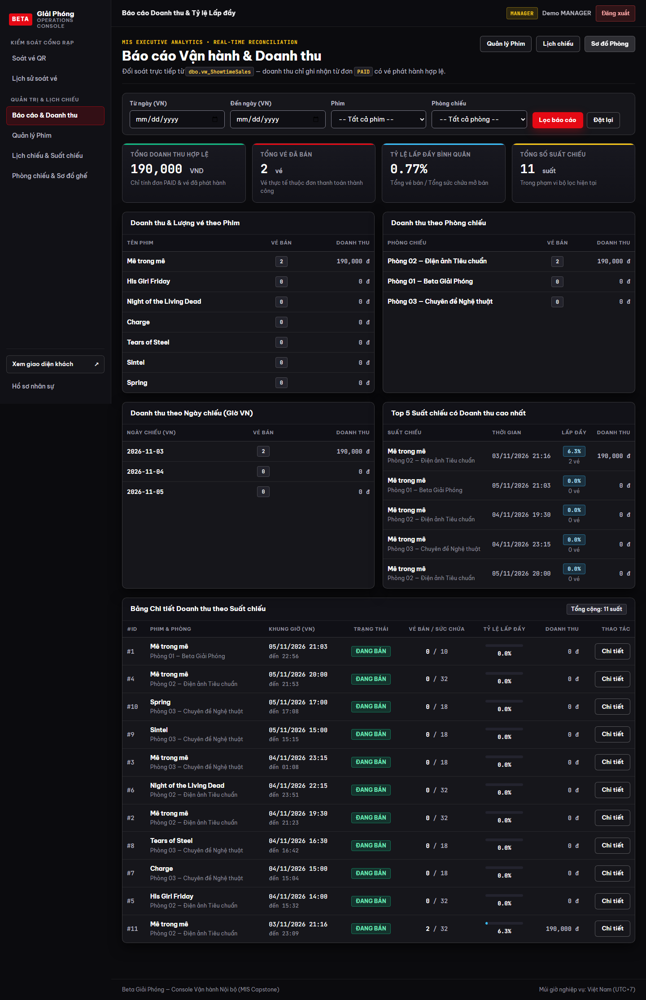

# Beta Giải Phóng Cinema

**Academic Cinema Ticketing & Operations Management System**

[](https://dotnet.microsoft.com/)
[](https://learn.microsoft.com/aspnet/core/mvc/overview)
[](https://learn.microsoft.com/ef/core/)
[](https://www.microsoft.com/sql-server/)
[](#run-locally)

An ASP.NET Core MVC application that demonstrates the end-to-end lifecycle of cinema ticketing: **movie discovery, showtime scheduling, concurrent seat reservations, simulated checkout, electronic QR tickets, staff check-in, and cinema operations management**.

> **Academic project / independent prototype.** This is a Management Information Systems (MIS) capstone showcase, not an official Beta Cinemas website. It is not affiliated with or endorsed by Beta Cinemas. Film information references real works and external sources; cinema schedules, prices, bookings, payments, and tickets are academic demonstration data. **No real transactions are processed.**
>
> **Availability:** Run locally with .NET and SQL Server. There is currently no publicly hosted live demo.

## Screenshots

The screenshots below document the application's customer and operations interfaces. They were captured during an earlier UI acceptance phase; some visuals may differ from the latest 31-film catalog and room-management release.

**Cinema home**



| Film discovery | Movie details |
|---|---|
|  |  |

| Interactive seat selection | Mock checkout |
|---|---|
|  |  |

| QR tickets | Staff check-in |
|---|---|
|  |  |

| Movie administration | Sales reports |
|---|---|
|  |  |

## Key Features

### Customer experience

- Browse a catalog seeded with **31 real films**, including provenance-aware movie metadata, posters, ratings, and optional official YouTube trailers.
- Search, filter, sort, and explore films; distinguish simulated upcoming showtimes from films without scheduled screenings.
- Select seats from an interactive seat map with standard/VIP pricing, an **8-seat maximum per order**, and a **5-minute reservation hold**.
- Complete a **development-only mock payment**, review order history, and receive electronic tickets with QR codes.

### Staff experience

- Validate tickets through a QR check-in screen with camera/file-scanning support.
- Detect previously used tickets, mismatched showtimes, and out-of-window check-ins.
- Review ticket scan history.

### Manager and operations experience

- Create, edit, publish, archive, and synchronize movie information while preserving manually locked fields.
- Create, edit, and delete cinema rooms when business rules permit; configure room technology (2D, 3D, IMAX, 4DX, VIP, and other supported types) and physical seat layouts.
- Publish, close, and cancel showtimes with scheduling and seat-availability safeguards.
- Review ticket sales, revenue, occupancy, and operational reports.

### Transaction integrity and security

- SQL Server transactions and explicit locking prevent competing customers from successfully reserving the same seat.
- All-or-nothing reservations, immutable seat-price snapshots, and automatic expiration of unpaid holds.
- HMAC-SHA256 verification and idempotent handling of mock payment callbacks.
- AES-256-GCM-protected QR token storage, single-use check-in enforcement, role-based authorization, and anti-CSRF protection.

## Technology Stack

| Layer | Technologies |
|---|---|
| Application | C#, .NET 10, ASP.NET Core MVC, Razor Views, REST APIs |
| Frontend | Custom CSS and vanilla JavaScript |
| Data access | Entity Framework Core 10, SQL Server, migrations |
| Authentication | ASP.NET Core cookie authentication and role-based policies |
| Testing | xUnit, ASP.NET Core WebApplicationFactory, Playwright / Chromium |
| Tooling | PowerShell, .NET CLI, GitHub Actions, optional Docker Compose |

## Architecture

```text
Browser (Razor views / JavaScript)
           |
           v
BetaGiaiPhong.Web  -- MVC, REST APIs, authentication, UI
           |
           v
BetaGiaiPhong.Data -- EF Core entities, transactions, domain services
           |
           v
       SQL Server

BetaGiaiPhong.Runner -- migrations, demo seed, verification
BetaGiaiPhong.Tests  -- unit, integration, web tests
e2e/                 -- Playwright browser tests
```

The implementation is a modular monolith: HTTP delivery and UI are separated from persistence and core ticketing services.

## Repository Layout

```text
.
├── src/
│   ├── BetaGiaiPhong.Web/       # ASP.NET Core MVC app and REST API
│   ├── BetaGiaiPhong.Data/      # EF Core model and business services
│   └── BetaGiaiPhong.Runner/    # Migration, seed and integrity CLI
├── tests/BetaGiaiPhong.Tests/  # Unit, SQL integration and web tests
├── e2e/                        # Playwright browser scenarios
├── scripts/                    # PowerShell developer helpers
├── sql/                        # Reference SQL scripts
├── docs/                       # Architecture, ERDs, guides, screenshots
├── docker-compose.yml          # Optional local SQL Server container
└── BetaGiaiPhong.slnx          # .NET solution
```

## Run Locally

### Prerequisites

- Windows PowerShell 5.1 or PowerShell 7.
- .NET 10 SDK and a running SQL Server instance (for example SQL Server Express).
- Git and a code editor such as VS Code.
- Node.js only if you intend to run the Playwright browser suite.

Clone and restore the solution:

```powershell
git clone https://github.com/vankhiem1609/beta-giai-phong-cinema.git
cd beta-giai-phong-cinema
dotnet tool restore --tool-manifest .\dotnet-tools.json
dotnet restore .\BetaGiaiPhong.slnx
```

**First-time installation only:** Configure stable cryptographic secrets. Do **not** regenerate these keys if you are using an existing database with issued tickets.

```powershell
$rng = [System.Security.Cryptography.RandomNumberGenerator]::Create()
$hmacBytes = New-Object byte[] 32; $rng.GetBytes($hmacBytes)
$aesBytes = New-Object byte[] 32; $rng.GetBytes($aesBytes)
dotnet user-secrets set "BGP_MOCK_HMAC_KEY_B64" ([Convert]::ToBase64String($hmacBytes)) --project .\src\BetaGiaiPhong.Web
dotnet user-secrets set "BGP_QR_AES_KEY_B64" ([Convert]::ToBase64String($aesBytes)) --project .\src\BetaGiaiPhong.Web
$rng.Dispose()
Remove-Variable hmacBytes, aesBytes -ErrorAction SilentlyContinue
```

Configure the connection string for **your** local SQL Server instance, then load the existing developer keys into the current PowerShell session:

```powershell
# Example for SQL Server Express. Adjust the instance name if needed.
$env:ConnectionStrings__BetaDb = "Server=localhost\SQLEXPRESS;Database=BetaGiaiPhong_Dev;Trusted_Connection=True;TrustServerCertificate=True;MultipleActiveResultSets=False"
. .\scripts\01_prepare_dev_session.ps1
```

On a **new, empty development database only**, initialize and seed the demonstration catalog. The password is chosen locally; no working credentials are committed to Git:

```powershell
$env:BGP_DEMO_PASSWORD = Read-Host "Set a local demo password (12+ characters)"
dotnet run --project .\src\BetaGiaiPhong.Runner -- migrate
dotnet run --project .\src\BetaGiaiPhong.Runner -- seed-verified-showcase
```

**Existing database?** Back it up and review pending migrations before applying schema changes. Do not re-run seeding unnecessarily: the seeder can update existing demo account passwords and catalog records.

Start the website:

```powershell
# Optional: enable the payment simulator only for local Development.
$env:BGP_ENABLE_MOCK_PAYMENT_SIMULATOR = "true"
dotnet run --project .\src\BetaGiaiPhong.Web --launch-profile http
```

Open **http://localhost:5145**. The HTTPS development profile uses `https://localhost:7097`.

On later sessions, use only your existing database connection, `. .\scripts\01_prepare_dev_session.ps1`, and the Web start command. See the [full installation guide](docs/delivery/INSTALLATION_GUIDE.md) for Docker, migrations, troubleshooting, and the first-time setup workflow.

### Demo Accounts

The current `seed-demo` implementation creates these sample users; all are assigned the locally chosen `BGP_DEMO_PASSWORD` at seed time:

| Role | Email |
|---|---|
| Customer | `customer1@demo.invalid` |
| Customer | `customer2@demo.invalid` |
| Staff | `staff@demo.invalid` |
| Manager | `manager@demo.invalid` |

These are demonstration identities, not real customer accounts.

## Tests and Verification

The repository includes unit, SQL Server integration, ASP.NET Core web-host, and Playwright browser tests. The source also includes a GitHub Actions CI workflow, but test counts and outcomes should be taken from a **specific verified run**, not from a static badge.

For isolated SQL Server tests, refer to [Installation Guide - Testing](docs/delivery/INSTALLATION_GUIDE.md) before enabling test-database creation. The test harness has ownership checks to protect existing databases.

```powershell
$env:BGP_TEST_ALLOW_DB_CREATE = "true"
$env:BGP_TEST_SQL_MASTER_CONNECTION = "Server=localhost\SQLEXPRESS;Database=master;Trusted_Connection=True;TrustServerCertificate=True;"
dotnet test .\BetaGiaiPhong.slnx -c Release
```

Additional test evidence and traceability: [Acceptance Summary](docs/delivery/TEST_ACCEPTANCE_SUMMARY.md) and [CI Workflow](.github/workflows/ci.yml).

## Documentation

- [Installation and troubleshooting](docs/delivery/INSTALLATION_GUIDE.md)
- [Architecture and database model](docs/delivery/ARCHITECTURE_AND_DATA_MODEL.md)
- [User manual](docs/delivery/USER_MANUAL.md)
- [Requirements traceability](docs/delivery/SRS_IMPLEMENTATION_TRACEABILITY.md)
- [Acceptance and test results](docs/delivery/TEST_ACCEPTANCE_SUMMARY.md)
- [Architecture diagrams](docs/figures/ERD_TongQuan_v1.png)
- [Documented open-license media manifest](src/BetaGiaiPhong.Web/wwwroot/media/movies/verified/ASSET_MANIFEST.json)

## Scope, Data, and Attribution

- The film catalog includes real movie titles and externally referenced metadata. Showing a film in the catalog **does not imply** that it is currently screening at a real Beta cinema.
- Showtimes, rooms, ticket prices, orders, payments, and QR admissions are part of a simulated academic environment. The payment simulator is not a real payment gateway.
- Film posters, backdrops, trailers, ratings, and other third-party materials remain subject to their respective source licenses and terms. The repository's open-license asset manifest documents a specific subset; it should not be assumed to cover every later-added asset.
- The repository currently does not include a root `LICENSE` file. Source-code licensing and third-party media redistribution rights must be reviewed separately before reuse or public deployment.

## Project Context

Developed as an MIS academic capstone and software-engineering portfolio project. The main engineering focus is **reliable ticketing workflows, relational data modeling, transaction consistency, security controls, and evidence-based testing**.

Repository: https://github.com/vankhiem1609/beta-giai-phong-cinema
