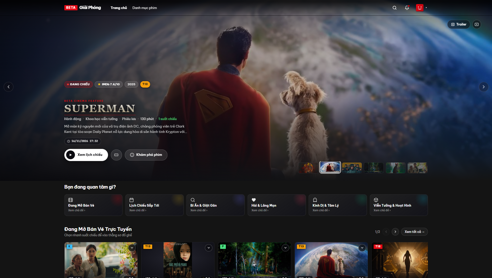
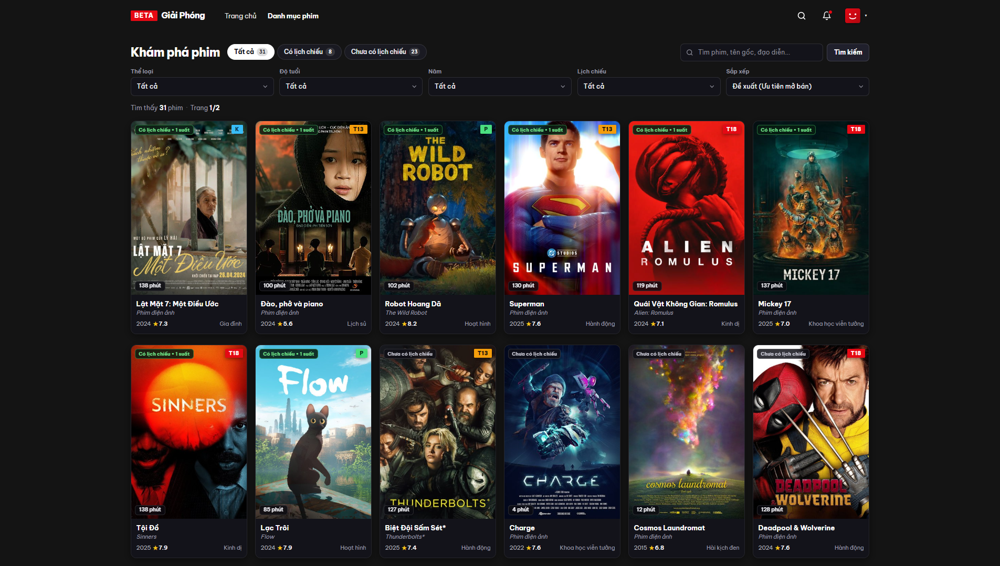
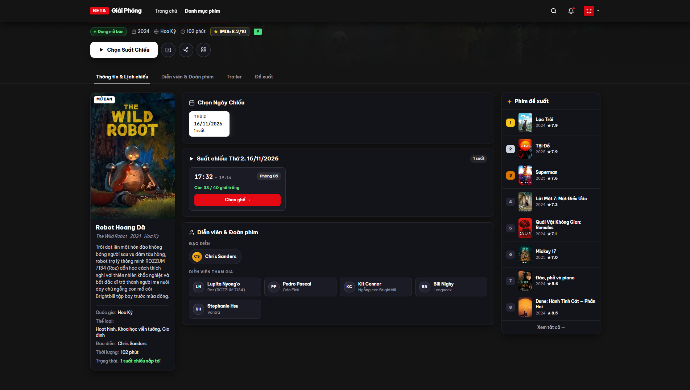
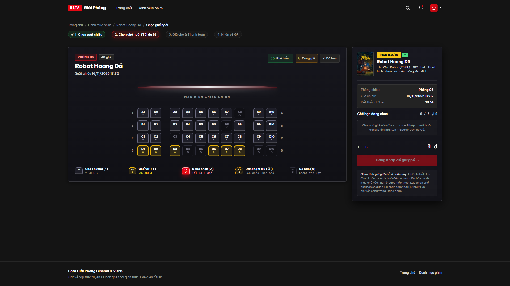
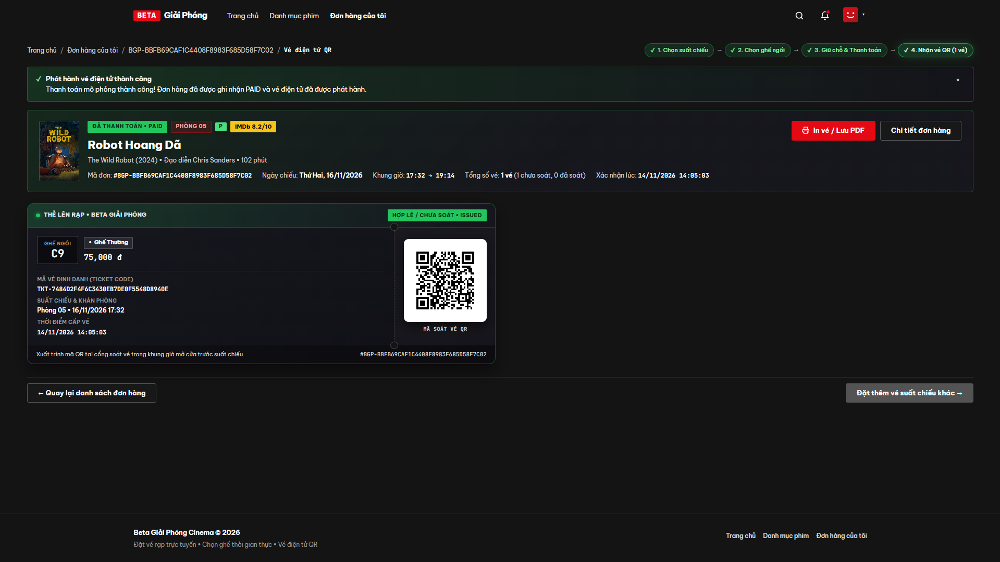
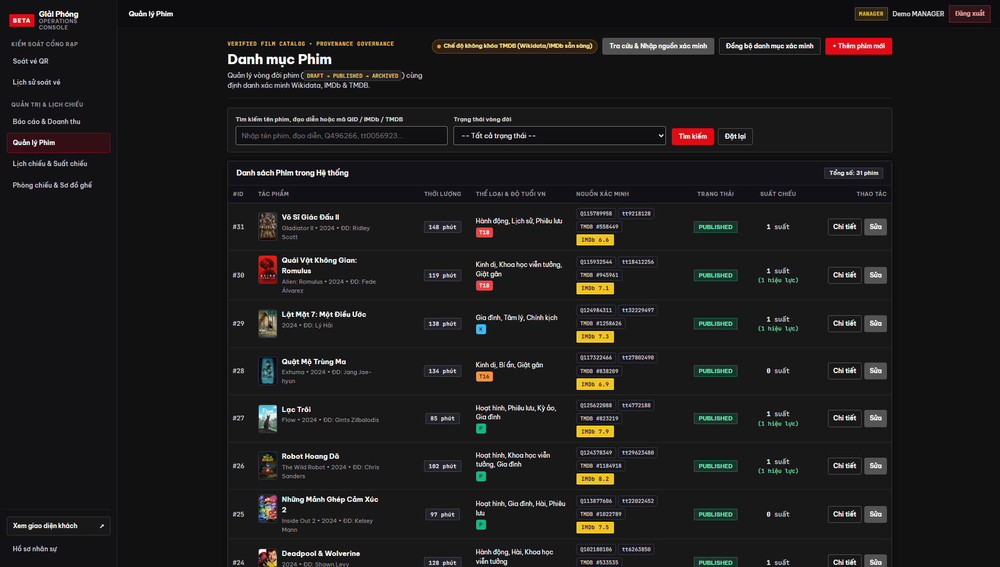
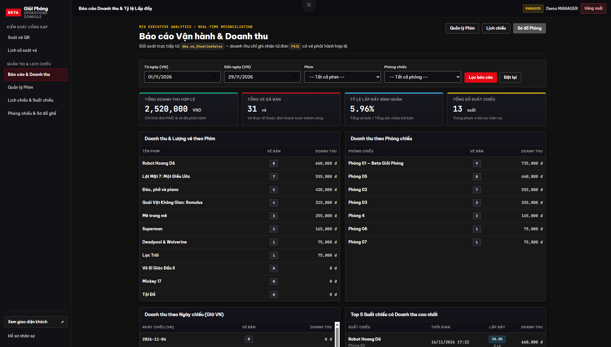
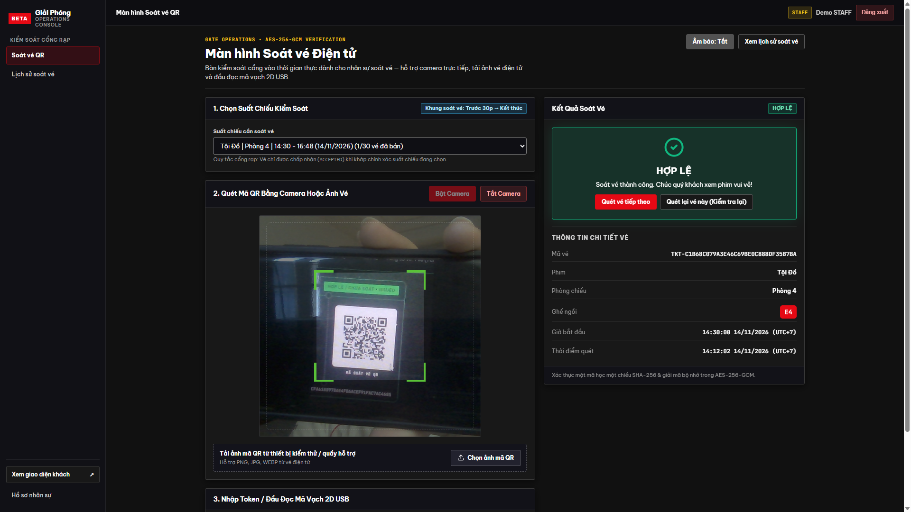

# Beta Giải Phóng Cinema

**Cinema Ticketing & Operations Management System | MIS Capstone / Software Engineering Portfolio**

[](https://dotnet.microsoft.com/)
[](https://learn.microsoft.com/aspnet/core/mvc/overview)
[](https://learn.microsoft.com/ef/core/)
[](https://www.microsoft.com/sql-server/)
[](#run-locally)

An academic, full-stack cinema application built with **ASP.NET Core MVC, Entity Framework Core, and Microsoft SQL Server**. It models the ticket-booking lifecycle, from discovering films and reserving seats to mock checkout, electronic QR tickets, staff admission, and cinema operations.

**Highlights:** concurrent seat reservation, time-limited holds, transactional state changes, signed mock-payment callbacks, single-use QR admission, role-based access control, and automated testing.

> [!IMPORTANT]
> **Independent academic prototype, not an official Beta Cinemas service.** This repository is not affiliated with or endorsed by Beta Cinemas. Real-film metadata may be referenced for demonstration, but schedules, seats, prices, orders, payments, and QR tickets are simulated. **No real payment or commercial ticket sale takes place.** There is no public Live Demo; the application runs locally.

## Screenshots

The following **eight screenshots were captured from the locally running application** and cover both the customer-facing cinema experience and the internal operations console. All screenshots are stored within this repository under [`docs/screenshots/`](docs/screenshots/).

### Cinema homepage



### Movie discovery and details

| Movie catalog | Movie details |
|---|---|
|  |  |

### Seat reservation and mock checkout

| Interactive seat selection | Simulated checkout |
|---|---|
|  |  |

### Cinema operations

| Movie administration | Sales and occupancy reports |
|---|---|
|  |  |

### Staff QR ticket check-in



> Screenshots illustrate a local academic demo. The repository also retains [earlier UI acceptance captures](docs/ui/screenshots/ui-p8/) for traceability; those captures are not used as the main gallery above.

## Features

### Customer-facing cinema experience

- Discover a curated showcase of **31 real film titles** with referenced metadata, genres, ratings, artwork, and optional YouTube trailers.
- Search and filter the catalog; view details and distinguish demo showtimes from films without scheduled screenings.
- Select **standard or VIP seats** using an interactive seat map, with an **eight-seat order limit**.
- Hold selected seats for **five minutes** and view a checkout countdown based on server-side expiration time.
- Complete a **development-only simulated payment**, review orders, and access electronic tickets with QR codes.

### Staff operations

- Validate QR tickets using camera or image-file scanning within the check-in interface.
- Reject duplicate scans, mismatched showtimes, and admissions outside the permitted time window.
- Review ticket scan history.

### Management console

- Create, update, publish, archive, and synchronize movie records; preserve manually overridden fields.
- Manage screening rooms and seat layouts (including room types and standard/VIP seating), with business-rule restrictions when a room has showtime history.
- Publish, close, or cancel showtimes subject to scheduling and capacity rules.
- Review ticket sales, revenue, seat occupancy, and operational reporting.

## Engineering Highlights

| Engineering challenge | Implementation | Relevant source |
|---|---|---|
| Double booking under concurrent requests | SQL Server `Serializable` transactions, showtime-level locks, and atomic seat-hold updates | [`SeatReservationService.cs`](src/BetaGiaiPhong.Data/Services/SeatReservationService.cs) |
| Abandoned reservations | Time-limited holds and a background expiration worker | [`ReservationExpiryWorker.cs`](src/BetaGiaiPhong.Web/Services/Workers/ReservationExpiryWorker.cs) |
| Duplicate or invalid payment callbacks | HMAC-SHA256 verification, idempotent processing, and transactional order/payment state transitions in a **mock** payment flow | [`PaymentService.cs`](src/BetaGiaiPhong.Data/Services/PaymentService.cs), [`MockPaymentSecurity.cs`](src/BetaGiaiPhong.Data/Services/MockPaymentSecurity.cs) |
| Ticket forgery and replay | Random QR token issuance, SHA-256 token hashes, AES-256-GCM encryption, and single-use scan state | [`QrTokenProtector.cs`](src/BetaGiaiPhong.Data/Services/QrTokenProtector.cs), [`TicketScanningService.cs`](src/BetaGiaiPhong.Data/Services/TicketScanningService.cs) |
| Role and session protection | Cookie authentication, role-based authorization policies, CSRF protection, rate limiting, and account-status revalidation | [`Program.cs`](src/BetaGiaiPhong.Web/Program.cs) |
| Safe room and seat management | Validated layouts, transactional updates, and restrictions protecting existing showtime history | [`RoomManagementService.cs`](src/BetaGiaiPhong.Data/Services/RoomManagementService.cs) |

These are implementation details of an academic system, not a claim of production security certification or readiness for real-money transactions.

## Technology Stack

| Layer | Technologies |
|---|---|
| Backend | C#, .NET 10, ASP.NET Core MVC, Razor Views, REST APIs |
| UI | Custom CSS, vanilla JavaScript, responsive customer/operations layouts |
| Database | SQL Server 2022+, Entity Framework Core 10, EF migrations |
| Identity & security | ASP.NET Core Cookie Authentication, role policies, antiforgery, HMAC-SHA256, AES-256-GCM |
| Testing | xUnit, `WebApplicationFactory`, SQL Server integration tests, Playwright (Chromium) |
| Development / CI | PowerShell, .NET CLI, Git, GitHub Actions, optional Docker Compose |

## Architecture

The project uses a **modular monolith**: MVC/API endpoints live in the Web project, business rules and persistence in the Data project, and development/database operations in a separate Runner CLI.

```text
Browser (Razor Views / JavaScript)
                  |
                  v
       BetaGiaiPhong.Web
   MVC / REST API / Authentication
                  |
                  v
       BetaGiaiPhong.Data
 EF Core / Domain Services / Transactions
                  |
                  v
             SQL Server

BetaGiaiPhong.Runner -> migrate / seed / verify
BetaGiaiPhong.Tests  -> unit / integration / web tests
e2e/                 -> Playwright browser tests
```

### Repository structure

```text
beta-giai-phong-cinema/
|-- src/
|   |-- BetaGiaiPhong.Web/       # MVC UI, APIs, authentication
|   |-- BetaGiaiPhong.Data/      # Entities, EF Core, domain services
|   `-- BetaGiaiPhong.Runner/    # Database and development CLI
|-- tests/BetaGiaiPhong.Tests/  # xUnit test projects
|-- e2e/                        # Playwright end-to-end tests
|-- scripts/                    # PowerShell setup and verification
|-- sql/                        # SQL reference scripts
|-- docs/
|   |-- screenshots/           # Current local UI screenshots (8 PNGs)
|   |-- delivery/              # Installation, architecture, acceptance
|   `-- ui/                    # Historical UI documentation
|-- .github/workflows/ci.yml   # GitHub Actions workflow
|-- docker-compose.yml         # Optional SQL Server container
`-- BetaGiaiPhong.slnx
```

## Run Locally

### Requirements

- Windows with PowerShell (the documented developer workflow), or an equivalent .NET environment.
- [.NET 10 SDK](https://dotnet.microsoft.com/download/dotnet/10.0).
- A running SQL Server instance (for example, SQL Server Express). A Docker Compose option is documented in the installation guide.
- Node.js is only required when running Playwright tests.

### A. Reopen an existing local database (recommended for returning developers)

From the repository root, use the **existing** SQL Server instance and stable cryptographic keys:

```powershell
# Example for a local SQL Server Express instance; adjust for your machine.
$env:ConnectionStrings__BetaDb = "Server=.\SQLEXPRESS;Database=BetaGiaiPhong_Dev;Trusted_Connection=True;TrustServerCertificate=True;MultipleActiveResultSets=False;"

# Load persistent development keys into the current PowerShell session.
. .\scripts\01_prepare_dev_session.ps1

# Optional: allow the mock payment simulator in Development only.
$env:BGP_ENABLE_MOCK_PAYMENT_SIMULATOR = "true"

dotnet run --project .\src\BetaGiaiPhong.Web --launch-profile http
```

Open **http://localhost:5145** (login: `http://localhost:5145/account/login`).

**Do not re-run migrations, seeding, or reset cryptographic keys just to reopen an existing application.** Preserve the original `BGP_QR_AES_KEY_B64` key: rotating it can invalidate access to QR tokens issued with the old key.

### B. First-time setup with a new, empty development database

Clone and restore:

```powershell
git clone https://github.com/vukhiem2005/beta-giai-phong-cinema.git
cd beta-giai-phong-cinema
dotnet tool restore --tool-manifest .\dotnet-tools.json
dotnet restore .\BetaGiaiPhong.slnx
```

Create persistent local secrets **once**, before starting the application (do not commit these values):

```powershell
$rng = [System.Security.Cryptography.RandomNumberGenerator]::Create()
$hmacBytes = New-Object byte[] 32
$aesBytes = New-Object byte[] 32
$rng.GetBytes($hmacBytes)
$rng.GetBytes($aesBytes)
dotnet user-secrets set "BGP_MOCK_HMAC_KEY_B64" ([Convert]::ToBase64String($hmacBytes)) --project .\src\BetaGiaiPhong.Web
dotnet user-secrets set "BGP_QR_AES_KEY_B64" ([Convert]::ToBase64String($aesBytes)) --project .\src\BetaGiaiPhong.Web
$rng.Dispose()
Remove-Variable hmacBytes, aesBytes -ErrorAction SilentlyContinue
```

For a **new database only**, configure SQL Server and seed the showcase:

```powershell
$env:ConnectionStrings__BetaDb = "Server=.\SQLEXPRESS;Database=BetaGiaiPhong_Dev;Trusted_Connection=True;TrustServerCertificate=True;MultipleActiveResultSets=False;"
$env:BGP_DEMO_PASSWORD = Read-Host "Choose a demo password (12 or more characters)"
. .\scripts\01_prepare_dev_session.ps1

dotnet run --project .\src\BetaGiaiPhong.Runner -- migrate
dotnet run --project .\src\BetaGiaiPhong.Runner -- seed-verified-showcase

dotnet run --project .\src\BetaGiaiPhong.Web --launch-profile http
```

See the [complete installation guide](docs/delivery/INSTALLATION_GUIDE.md) for Docker setup, troubleshooting, key management, and optional demo data.

### Demo accounts

The current `DemoSeeder` creates the following **four** demo accounts if they do not already exist:

| Role | Email | Example workflow |
|---|---|---|
| Customer | `customer1@demo.invalid` | Reserve seats, simulate payment, view QR ticket |
| Customer | `customer2@demo.invalid` | Exercise conflicting-seat and access-control scenarios |
| Staff | `staff@demo.invalid` | Check in QR tickets and review scan history |
| Manager | `manager@demo.invalid` | Maintain movies, rooms and showtimes; inspect reports |

New accounts receive the password supplied in `BGP_DEMO_PASSWORD` during seeding. **Existing demo users keep their current password hashes**; seeding does not recover forgotten passwords. No account passwords or production credentials are distributed in this repository.

## Testing and Quality Evidence

The repository provides automated unit, SQL Server integration, ASP.NET Core web-host, and browser tests, as well as CI jobs for build/static checks, tests, database invariants, and Playwright.

**Documented historical acceptance results** (from project reports; **not freshly rerun for this README update**):

| Verification | Recorded result | Evidence |
|---|---:|---|
| xUnit unit / integration / web tests | **173 / 173 passed** | [UI-P8 acceptance report](docs/ui/UI_P8_FINAL_ACCEPTANCE_REPORT.md) |
| Playwright Chromium tests | **50 / 50 passed**, across 15 spec files | [UI-P8 acceptance report](docs/ui/UI_P8_FINAL_ACCEPTANCE_REPORT.md) |
| SQL Server integrity verification | **9 / 9 invariant groups passed** | [UI-P8 acceptance report](docs/ui/UI_P8_FINAL_ACCEPTANCE_REPORT.md) |

These results were recorded at a specific local acceptance milestone. They do **not** establish that the latest commit has a passing CI run. See [GitHub Actions](https://github.com/vukhiem2005/beta-giai-phong-cinema/actions) for current workflow status and [test acceptance documentation](docs/delivery/TEST_ACCEPTANCE_SUMMARY.md) for earlier release evidence.

The [physical-camera UAT plan](docs/delivery/MANUAL_CAMERA_UAT.md) documents manual scanner/device scenarios; those scenarios are **not claimed as completed tests**.

For test environments and database-isolation safeguards, refer to the [installation guide](docs/delivery/INSTALLATION_GUIDE.md) before running the suite. Avoid pointing test commands at an existing personal or production database.

## Documentation

| Resource | Description |
|---|---|
| [Installation Guide](docs/delivery/INSTALLATION_GUIDE.md) | Prerequisites, environment variables, database setup and troubleshooting |
| [Architecture and Data Model](docs/delivery/ARCHITECTURE_AND_DATA_MODEL.md) | System boundaries, schema, transaction design and APIs |
| [User Manual](docs/delivery/USER_MANUAL.md) | Customer, staff and manager workflows |
| [Requirements Traceability](docs/delivery/SRS_IMPLEMENTATION_TRACEABILITY.md) | Requirements and implementation mapping |
| [Acceptance Summary](docs/delivery/TEST_ACCEPTANCE_SUMMARY.md) | Prior test phases and quality evidence |
| [UI-P8 Acceptance Report](docs/ui/UI_P8_FINAL_ACCEPTANCE_REPORT.md) | Final UI-phase acceptance and previous screenshots |
| [Manual Camera UAT](docs/delivery/MANUAL_CAMERA_UAT.md) | Physical-device testing procedure and status |
| [Asset Manifest](src/BetaGiaiPhong.Web/wwwroot/media/movies/verified/ASSET_MANIFEST.json) | Attribution and license metadata for documented media assets |

## Scope, Limitations, and Attribution

- **Academic scope:** This is an independent MIS capstone prototype, not an official Beta Cinemas ticketing platform.
- **Real film references vs. simulated operations:** Film titles and related metadata reference external sources; actual schedules, seats, prices, bookings, payments, ticket issuance and reports are local demonstration data.
- **Mock payments only:** No real payment provider, financial settlement or live customer transaction is implemented.
- **Local execution:** The repository provides source code and local setup instructions; it does not currently offer a hosted public Live Demo.
- **Media rights:** Third-party movie posters, backdrops, trailer links and rating information remain subject to their respective owners' terms. The [asset manifest](src/BetaGiaiPhong.Web/wwwroot/media/movies/verified/ASSET_MANIFEST.json) covers a documented subset, not necessarily all assets added later.
- **Source licensing:** The repository does not currently contain a root `LICENSE` file. Public visibility alone does not grant blanket permission to redistribute code or third-party media.
- **Deployment readiness:** The application has not been presented as an audited, commercially deployed booking or payment system.

---

**Repository:** [github.com/vukhiem2005/beta-giai-phong-cinema](https://github.com/vukhiem2005/beta-giai-phong-cinema)
**Focus:** ASP.NET Core / SQL Server / concurrency control / secure QR workflows / evidence-based software testing.
